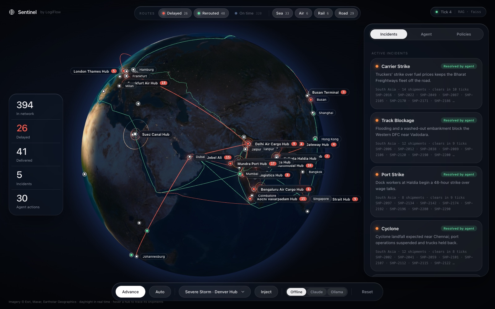
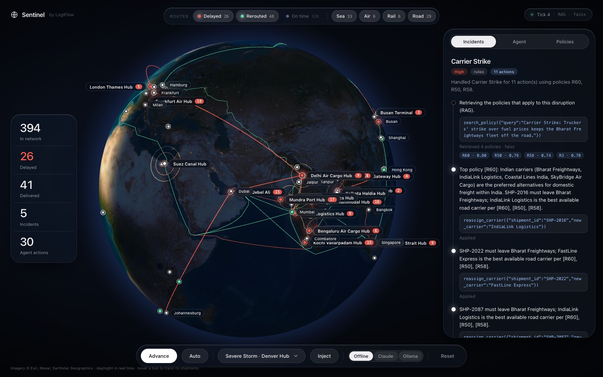
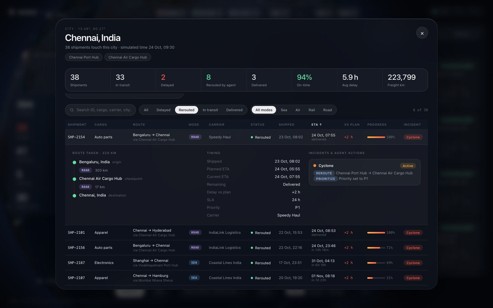
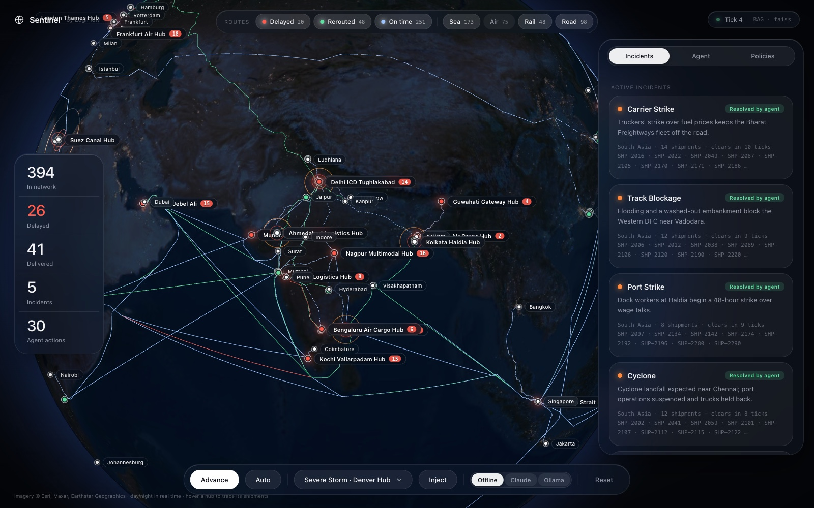

# LogiFlow Sentinel 🛡️

## Problem Overview
Global supply chains are increasingly fragile. When disasters strike (storms, strikes, port closures), logistics coordinators are overwhelmed with alerts and struggle to manually reroute shipments before SLAs are breached. 

## Solution
**LogiFlow Sentinel** is an AI-powered autonomous logistics agent that monitors a live supply chain feed. When a disruption occurs, the Agent automatically analyzes the impact, consults the operational knowledge base, and executes tools (rerouting, prioritizing, reassigning) to mitigate delays—all fully observable via a real-time command dashboard.

## Screenshots

<p align="center">
  
</p>
<p align="center"><sub><b>Live network.</b> Real-time day/night globe, surface routes for sea/rail/road, pulsing incident rings, and route filters whose counts cross-filter by status and mode.</sub></p>

<table>
  <tr>
    <td width="50%"></td>
    <td width="50%"></td>
  </tr>
  <tr>
    <td><sub><b>Agent trace.</b> The LangGraph agent retrieves policies from FAISS (<code>R60 · 0.80</code>), reasons with rule citations, and acts through guardrailed tools.</sub></td>
    <td><sub><b>City dashboard.</b> KPIs, incidents, and a sortable shipment table; expand a row for the route taken, timing and agent-action history.</sub></td>
  </tr>
</table>

<p align="center">
  
</p>
<p align="center"><sub><b>India layer.</b> Ports, air-cargo hubs and dry ports with routes that follow coastlines, the freight corridors and real highways.</sub></p>

## Architecture
See `docs/architecture_diagram.md` for the full diagram.

```
Simulator ──disruption──▶ LangGraph:  retrieve ─▶ agent ⇄ tools ─▶ END
    ▲                                    │          │      │
    │                              FAISS (RAG)    LLM   Toolbox (reroute / reassign /
    └──────────── state changes ◀───────────────────────  prioritize / escalate)
                               ▼
                       3D globe UI (FastAPI + globe.gl): incidents, audit, agent trace
```

## RAG + agentic workflow
* **RAG**: the 60 operational policies are embedded locally (FastEmbed `bge-small`, no API key) into a **FAISS** vector store via LangChain, and retrieved semantically. Answers cite rule IDs (`[R12]`).
* **Agent**: a **LangGraph** state graph (`retrieve → agent ⇄ tools`) with LangChain tools that really mutate the simulation, validate inputs, and return errors the agent can recover from. Reasoning engines: Claude (`langchain-anthropic`), Ollama (`langchain-ollama`), or an offline deterministic model so the demo needs no keys.
* **Evaluation**: `python -m src.evaluate` reports retrieval hit@4 (FAISS 96% on 25 cases) and action accuracy; `pytest` covers guardrails and the graph.

## Setup
```bash
python -m venv .venv && source .venv/bin/activate
pip install -r requirements.txt
cp .env.example .env        # optional: add ANTHROPIC_API_KEY to use Claude
python -m src.server   # http://localhost:8501
```
The first run downloads the small embedding model and builds the FAISS index.

## Data
`scripts/generate_data.py` builds a reproducible dataset (seed 42): **~420 shipments** on ~140 lanes (sea, air, rail, road) across **53 hubs** and 63 cities, and **57 disruption scenarios** (typhoons, Suez and Panama canal issues, port and rail strikes, airspace closures, earthquakes, cyber attacks, cold-chain failures, sanctions holds, carrier insolvency...). Each scenario's affected shipments are the ones that really pass through that hub or use that carrier.

There is a deep **India** layer: 16 cities; ports at Mundra, Nhava Sheva, Chennai, Haldia, Visakhapatnam and Kochi; air-cargo hubs; dry ports and ICDs; Western/Eastern Dedicated Freight Corridor rail; four Indian carriers; and 21 India scenarios (cyclones, monsoon floods, a truckers' strike, Delhi fog, customs holds, heatwave cold-chain failure, DFC track blockage...).

Every shipment has cargo, mode, carrier, shipped time, planned and current ETA. Disruptions expire after a few ticks, shipments are delivered when the simulation clock reaches their ETA, and new ones are dispatched every tick. **Auto** mode runs the simulation live.

## Globe
Shipments move over real surface routes: **sea** freight is path-found through an ocean mask built from Natural Earth coastlines (with the Suez and Panama canals), **road** follows OSRM driving geometry, **rail** follows hand-built corridors (Silk Road / Middle Corridor, Trans-European lines), and only **air** freight flies as arcs. Inland ends of sea freight get a road feeder to the port, and rerouting respects hub capabilities (vessels only call at ports, aircraft at airports). Base lanes are precomputed by `scripts/build_routes.py` into `data/routes.json`; reroutes are routed on demand (new road legs need internet, otherwise a straight line is drawn).

Satellite imagery streams as map tiles (Esri World Imagery) so it stays sharp at any zoom; a bundled texture is the offline fallback. The night side is shaded in real time from the sun's current position, with city lights on the dark side.

## Controls
* **Routes bar** (top): toggle **Delayed / Rerouted / On time** and **Sea / Air / Rail / Road**. The counts cross-filter: with only *Delayed* on, the mode chips show how many delayed rail, road, sea and air routes there are, and vice versa. Your choice is remembered.
* **Hover a hub** to list its shipments and trace all of them; **click** it (or any city) for the dashboard.
* **Dock** (bottom): *Advance* one tick, *Auto* run, a searchable scenario picker with *Inject*, the reasoning engine (Offline / Claude / Ollama), *Reset*.
* **Side panel**: Incidents, the live Agent trace (retrieved policies, tool calls, observations), and Policy search.

## City / hub dashboard
Click any city or hub on the globe to open its dashboard: KPIs (on-time %, delays, reroutes, freight km), the incidents affecting it, and a sortable, filterable table of every shipment with shipped time, current vs planned ETA, progress, carrier, mode and status. Expand a row for the full route taken (legs, modes, km, current position), timing, and the incident/agent-action history. Times run on a simulation clock that advances each tick; shipments are delivered when the clock reaches their ETA and new ones are dispatched continuously.

## Tests, evaluation and rebuilding data
```bash
pytest -q                          # 19 tests: guardrails, graph, routing, API, dataset consistency
python -m src.evaluate             # retrieval hit@4 + action accuracy (--local = TF-IDF baseline)
python scripts/generate_data.py    # regenerate shipments + scenarios
python scripts/build_routes.py     # regenerate data/routes.json (road legs call the public OSRM server)
```
`scripts/build_ocean_mask.py` rebuilds `data/ocean_mask.npz` from a Natural Earth 50m land GeoJSON; it needs `shapely` (build-time only, not in `requirements.txt`).

## Data sources and attribution
Coastlines: Natural Earth (public domain). Satellite imagery: Esri World Imagery. Road geometry: OSRM public demo server (base lanes are cached in `data/routes.json`). All shipments, carriers and disruption scenarios are synthetic.

## Known limitations
* The offline "rules" engine follows a fixed playbook, so its 100% action accuracy checks the plumbing, not an LLM's judgment. Real reasoning needs Claude or Ollama (both implemented, untested without keys).
* Sea routes are accurate to the 0.25 degree grid; they can clip small headlands or islands by up to about 1 degree.
* Routing is not incident-aware: after a Suez blockage, rerouted sea shipments are sent to a new hub but their drawn route can still pass through the canal.
* Rail follows hand-built corridors rather than a full rail network; new road legs need internet the first time (otherwise a straight line is drawn).

## Demo
1. Pick a scenario in the bottom dock and click **Inject** (or **Advance** for random disruptions); the globe flies to the incident.
2. Watch the agent retrieve policies, act, and resolve the incident under **Agent**.
3. Try **Policies** to query the vector store directly.

## Tech Stack
FastAPI · globe.gl (three.js) · LangChain · LangGraph · FAISS · FastEmbed · Claude / Ollama

## Future Improvements
* Real ELD / carrier API integrations.
* Weather-weighted routing and per-region agents.
* Hybrid (dense + sparse) retrieval and reranking.
