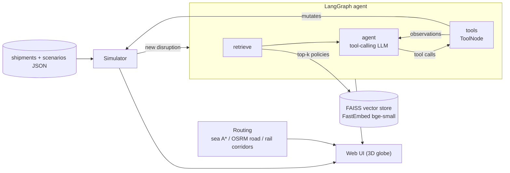

# LogiFlow Sentinel Architecture

## Components
| Module | Role |
|---|---|
| `src/simulator.py` | Live feed on a simulation clock: advances shipments, delivers them at their ETA, dispatches new ones, injects and expires disruptions |
| `src/geo.py` | Cities, hubs, and hub capabilities (port / air / ground) used for guardrails and reroute choices |
| `src/routing.py` | Surface routes: sea path-finding over an ocean mask (Suez/Panama gates), OSRM road geometry, hand-built rail corridors; cached in `data/routes.json` |
| `src/rag.py` | LangChain `Document`s from `knowledge_base.txt`, embedded locally and stored in FAISS (cached in `.cache/`); TF-IDF fallback |
| `src/agent.py` | LangGraph `StateGraph`: `retrieve → agent ⇄ tools → END`. Chat model: Claude, Ollama, or an offline deterministic `RuleChatModel` |
| `src/tools.py` | LangChain tools (`search_policy`, `get_shipment`, `reroute_shipment`, `reassign_carrier`, `prioritize_shipment`, `escalate_to_operator`, `finish`) over a guardrailed `Toolbox` |
| `src/evaluate.py` | hit@k retrieval and action accuracy over `data/eval_cases.json` |
| `src/server.py` | FastAPI app: owns the simulation/agent session; JSON API (`/api/state`, `/api/tick`, `/api/inject`, `/api/routes`, `/api/node`, `/api/search`...) |
| `scripts/` | Reproducible data builders: `generate_data.py`, `build_routes.py`, `build_ocean_mask.py` |
| `web/` | Hand-built front end: globe.gl 3D globe with real-time night side, route filters, incident feed, live agent trace, policy search, and the city/hub dashboard (libraries vendored) |

## Agentic flow per incident
1. Simulator surfaces a new disruption.
2. `retrieve` node: RAG over the policy base grounds the agent in cited rule IDs.
3. `agent` node: the LLM reasons and emits tool calls; it may call `search_policy` again (agentic RAG).
4. `tools` node: the Toolbox validates (delivered shipments immutable, struck carriers blocked, carriers must support the shipment's mode, hubs must support it too: vessels only call at ports, aircraft at airports) and mutates live state. Rejections come back as observations so the agent can self-correct.
5. The loop ends on `finish` (summary + risk level); the full trace is shown in the UI.
